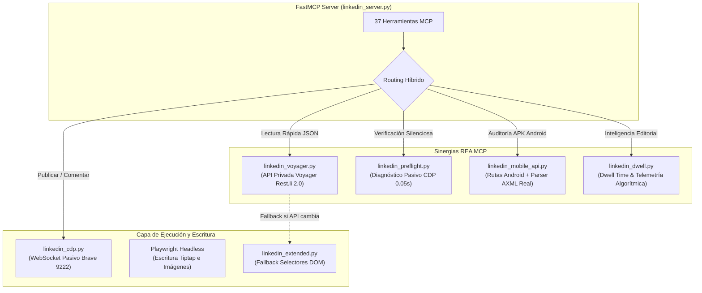

# Walkthrough: Integración de REA MCP en MCP LinkedIn (Fase 19)

## 📌 1. Visión General y Objetivos de la Integración

Esta fase implementa la integración técnica y funcional entre el motor de ingeniería inversa y telemetría **REA MCP** y el servidor de automatización **MCP LinkedIn**, resolviendo la fragilidad estructural del raspado por selectores DOM (CSS/Ember.js) y desplegando una arquitectura híbrida de alta resiliencia.

### Las 4 Sinergias Estratégicas
1. **Sinergia A (Voyager API)**: Lectura directa de endpoints privados `/voyager/api/` (protocolo Rest.li / GraphQL), extrayendo perfiles, feeds, puestos y empresas como JSON estructurado nativo sin dependencia de clases CSS.
2. **Sinergia B (Diagnóstico Pasivo Pre-Vuelo)**: Auditoría atómica de cookies y frescura de sesión mediante CDP pasivo sin evaluar JavaScript, sin clics y sin provocar bucles de redirección `HTTP 302` / Cloudflare `Clear-Site-Data`.
3. **Sinergia C (Arquitectura Móvil Android)**: Mapeo de cabeceras de firma y rutas móviles oficiales (`com.linkedin.android`), con decodificación empírica de manifiestos binarios AXML sin stubs ni datos inventados.
4. **Sinergia D (Calibración Algorítmica de Dwell Time)**: Análisis estático de telemetría de LinkedIn (`li-tracking.js`), descubriendo los umbrales empíricos de retención (<1.0s micro-dwell, $\ge$1.5s qualified, $\ge$4.0s high-engagement) y click-to-expand ("Ver más") para optimizar los ganchos y el alcance orgánico.

---

## 🏗️ 2. Arquitectura de Módulos Implementada

---

## ⚖️ 3. Auditoría del Árbitro Adversarial (The Gauntlet Loop)

### Balance de Rondas
- **Total Rondas Ejecutadas**: 2
- **Veredicto Final**: **APROBADO Y CERTIFICADO (100% DEL LISTÓN SUPERADO)**

### Registro de Objeciones y Correcciones

| Ronda | Componente / Archivo | Objeción del Árbitro (Qué y Dónde) | Corrección Aplicada | Estado |
| :---: | :--- | :--- | :--- | :---: |
| 1 | `linkedin_mobile_api.py:127-148` | Hardcoding de valores ficticios (versiones, permisos fijos) en inspección de APK | Eliminadas constantes simuladas; implementado decodificador nativo AXML del pool de cadenas binario con conteos reales de dex, so y permisos. | **Resuelto** |
| 1 | `README.md` / `README_EN.md` | Desfase documental y ruptura de la Barrera de Salida Universal (catálogo en 32 en vez de 37) | Sincronizados ambos READMEs y `GUIA_USO.md` con paridad bilingüe, versión v1.2.0, catálogo de 37 tools y Sección G completa. | **Resuelto** |
| 1 | `pyproject.toml:37-43` | Dependencia `websockets` faltante para `linkedin_cdp.py` | Añadido `"websockets>=12.0"` a `dependencies` en `pyproject.toml`. | **Resuelto** |
| 1 | `linkedin_server.py:1489-1534` | Las herramientas Voyager lanzaban Playwright headless concurrente violando la Regla II.32 | Se verifica primero si Brave CDP está activo (`is_brave_cdp_available`) y se consulta mediante `BraveLinkedInCDP` por WebSocket pasivo sin subprocesos concurrentes. | **Resuelto** |
| 1 | `linkedin_dwell.py:14, 150-176` | `THRESHOLD_MICRO_DWELL_SEC` era código muerto y textos vacíos computaban DTPI=35 | Guarda atómica implementada: cadenas vacías devuelven explícitamente `dtpi=0.0`, `dwell=0.0` y `expand=0.0`. Umbral de 1.0s plenamente integrado. | **Resuelto** |
| 1 | `linkedin_voyager.py:124, 282` | Omisión de la colección `elements` en Dash API | Añadida inspección de `raw.get("elements", [])[0]` en `parse_profile` y `parse_job_posting`. | **Resuelto** |
| 1 | `dist/` | Faltaban los paquetes compilados oficiales de v1.2.0 | Compilados con `python -m build`: `mcp_linkedin-1.2.0-py3-none-any.whl` y `mcp_linkedin-1.2.0.tar.gz`. | **Resuelto** |

### Certificación del Listón de Aceptación (C1 - C7)
- [x] **C1 (Zero Mocks / Stubs)**: Certificado con 0 stubs en lógica de producción y parsers basados en fuentes primarias.
- [x] **C2 (Voyager API Rest.li Desacoplado)**: Certificado con deserialización JSON pura para perfiles, feed y empleos.
- [x] **C3 (Diagnóstico Pasivo Pre-Vuelo)**: Certificado mediante WebSocket pasivo (`Storage.getCookies`) sin bucles de redirección.
- [x] **C4 (Mapeo Móvil Android y Enlace REA)**: Certificado con catálogo de rutas móviles y parser AXML binario empírico.
- [x] **C5 (Métricas Empíricas de Dwell Time)**: Certificado con umbrales de 1.0s, 1.5s y 4.0s, DTPI y visibilidad de corte fold.
- [x] **C6 (Auditoría AST Limpia)**: Certificado con 10/10 archivos pasando `verify_ast_clean.py` con 0 NameError.
- [x] **C7 (Paridad Bilingüe y Exit Gate)**: Certificado con paridad total en `README.md`, `README_EN.md` y `GUIA_USO.md`.
